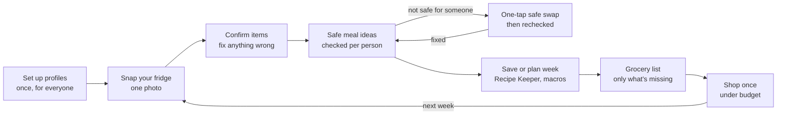

# Shelf Life — Product Requirements Document

**Oct 20, 2026 · @Makissa**

Shelf Life turns a photo of your fridge into meals that are safe for everyone at your table, with macros, cost per serving and one weekly grocery list.

**Team:** Makissa Peterson, Eleanor Woolley, Kate Hatch · ENT 401

---

## 1. Overview

**Problem.** Households throw away food they bought, don't know what to make with what they have, and juggle separate tools for recipes, grocery lists and nutrition. For households with an allergy, celiac disease or a diet, every meal also has to be checked against each person. In our survey of 18 people, 83% threw groceries away in the past two weeks, and 5 of the 6 who had tried a meal app stopped using it. Published research backs this up: about 21% of the US food supply is lost at the consumer level (USDA ERS), and a lack of meal planning is a main driver of household waste (Romani et al., *Appetite*, 2018). Full evidence is in the Product Discovery & Validation doc.

**Solution.** One app that goes from a fridge photo to safe meals, macros, cost per serving and a weekly grocery list.

**What makes it different.** Competitors do one piece: SuperCook and meChef find recipes from ingredients, Mealime plans the week, MyFitnessPal tracks macros. Shelf Life combines them, and every suggestion is checked against each person's restrictions for free.

### Product goals

1. Make "what can I make with what I have?" a 2-minute answer.
2. Cut the food households throw away.
3. Make every suggested meal safe for everyone eating it, and show why.
4. Give macros and cost for every meal without extra data entry.

### Success metrics (first 6 months after launch)

| Metric | Target | Why it matters |
|---|---|---|
| Users still active at day 30 | ≥ 20% | Health apps average about 3–16% (Apptopia), so this beats the category |
| Fridge scans per active user per week | ≥ 2 | The core habit |
| Users reporting less food thrown away after 4 weeks | ≥ 60% | The waste promise |
| Suggested meals flagged as unsafe by a user after cooking | 0 | The safety promise |
| Free to Premium conversion | ≥ 5% | Business viability; 33% of surveyed people said they'd pay |

---

## 2. Target users and user stories

**Primary persona: the household cook.** The person who decides what gets cooked, for themselves or for others.

- **Individuals:** single adults, couples, roommates and college students. In our survey they wanted fridge meals and macros most, and 85% track macros at least sometimes.
- **Families:** a parent planning for 3–5 people. Every surveyed family wanted the weekly grocery list.
- **Households with restrictions** sit inside both groups: someone with a food allergy, celiac disease, an intolerance or a chosen diet.

### Accounts and profiles

- Every account belongs to one adult (18+). Logins are never shared.
- A parent can add child profiles that have no account. When a child turns 18, they need their own account to stay in the family; the parent's account can link to theirs.
- Roommates each have their own account, fridge and grocery list. Food is never pooled between accounts.
- Anything the app creates (recipes, meal plans, grocery lists, care cards) can be shared by link, text or print. People receiving it don't need an account.
- US only at launch: imperial units, USD prices.

### User stories

| # | As a household cook, I want to… | So that… | Priority |
|---|---|---|---|
| U1 | snap one photo of my fridge and confirm what it found | I don't have to type in my ingredients | Must |
| U2 | get meal ideas for any meal of the day that use what I already have, starting with what goes bad first | I waste less food | Must |
| U3 | add each person I cook for, including children without accounts, and their allergies, intolerances and diets | every meal works for everyone | Must |
| U4 | see why a meal is safe for each person, ingredient by ingredient | I can trust it and double-check | Must |
| U5 | get a one-tap swap when a meal isn't safe as written | I can still cook the recipe | Must |
| U6 | see macros (calories, protein, carbs, fat) for each serving | I can follow my nutrition goals | Must |
| U7 | keep all my recipes in a Recipe Keeper with folders and tags, and change the serving size | I can find, organize and scale my recipes | Must |
| U8 | add my own recipes from a link, pasted text or a photo of a cookbook page | my family favorites are in one place | Must |
| U9 | get one weekly grocery list with only what I'm missing | I shop once and don't buy duplicates | Must |
| U10 | mark a label as checked once and have the app remember it | I don't recheck the same product every week | Must |
| U11 | plan the week's meals in advance, with leftovers | I can meal-prep | Should |
| U12 | set a weekly budget and see cost per serving | I stay on budget | Should |
| U13 | share a recipe, plan, list or care card with someone | others can use what the app made for me | Should |
| U14 | scan a product's barcode to check its real ingredients and allergen warnings (Premium) | I get a specific answer instead of "check the label" | Should |
| U15 | send a care card to a babysitter, grandparent or roommate | others know the food rules | Could |

### Core user flow

*One fridge photo leads to safe meals and a weekly list.*

*Shelf Life weekly loop · 7 steps + safe-swap branch*

Profiles are set once. Each week, one fridge photo becomes meal ideas checked against every person; a meal that isn't safe gets a one-tap swap and is checked again before it can be saved, planned or added to the grocery list.

---

## 3. Features and requirements

The MVP is the weekly loop: profiles → fridge photo → safe meals → Recipe Keeper and plan → grocery list. **Everything is free except barcode scanning**, which is the only Premium feature.

| Feature | Requirement | Stories | Release | Tier |
|---|---|---|---|---|
| Accounts and profiles | One adult per account; child profiles without accounts; separate accounts for roommates (see section 2) | U3 | MVP | Free |
| Allergen and diet filters | Strict allergy or intolerance for the 9 major allergens (milk, eggs, fish, shellfish, tree nuts, peanuts, wheat, soy, sesame) and gluten/celiac; diets: low-FODMAP, keto, halal, high-protein, macro-focused, vegan, vegetarian; custom "avoid" foods | U3 | MVP | Free |
| Fridge photo scan | One photo lists the items found; unsure items are dashed and must be confirmed; 10 photo scans a week, resetting Monday; receipt scans and typing are unlimited | U1 | MVP | Free |
| Fridge inventory | Items stay in the fridge between scans; marking a meal "cooked" removes its ingredients; items are "have" or "don't have" (no quantities in the MVP) | U1, U9 | MVP | Free |
| Use-first list | Estimates days left per item and puts meals that use them at the top | U2 | MVP | Free |
| Safe meal suggestions | 3–5 ideas for breakfast, lunch, dinner or snacks from confirmed items; "Who's eating?" picker; badge: Safe / Safe after a label check / Safe for X of Y with a fix; "makes leftovers" tag | U2, U4 | MVP | Free |
| Show your work | Per person, every ingredient checked and why it passes, fails or needs a label check | U4 | MVP | Free |
| One-tap safe swap | Suggests a swap (e.g., tamari for soy sauce, oat milk for cheddar) and rechecks the meal | U5 | MVP | Free |
| Remembered label checks | User taps "I checked the label" per item; the app remembers it and shows a warning to recheck when a new package of that item is added, or (with Premium) when the barcode shows a different product or manufacturer | U10 | MVP | Free |
| Recipe Keeper | Holds AI-suggested, partner and own recipes; folders, tags and search; servings scaling rescales ingredients, macros and cost; every recipe shows its source | U7 | MVP | Free |
| Recipe import | From a link, pasted text or a photo of a cookbook page; becomes an editable recipe and gets a safety check | U8 | MVP | Free |
| AI recipe creation and balancing | When no saved recipe fits, AI creates one from confirmed items and balances portions and macros as well as it can; labeled "AI-generated"; passes the same safety check as every recipe | U2, U6 | MVP | Free |
| Partner recipes | Recipes from partner recipe apps and publishers, shown with attribution | U2 | V2 | Free |
| Macros per serving | Calories, protein, carbs and fat per serving from USDA FoodData Central; shown only, no goals or targets | U6 | MVP | Free |
| Cost per serving and budget | US national average prices in USD, labeled as estimates; pantry staples (oil, salt, spices) excluded; weekly budget tracker | U12 | MVP | Free |
| Weekly meal planner | Drag recipes onto days for every meal; leftovers fill later slots; list updates automatically | U11 | MVP | Free |
| Weekly grocery list | Planned meals minus what's in the fridge; label warnings per person; estimated total vs. budget | U9 | MVP | Free |
| Sharing | Share recipes, plans, lists and care cards by link, text or print; no account needed to view | U13 | MVP | Free |
| Report a problem | A button on every meal to report a safety or recipe problem | — | MVP | Free |
| Barcode label scan | Scan a package to read its ingredients and allergen statements from a product database; marks it safe or unsafe for each person; alerts when the product or manufacturer changes | U14 | MVP | Premium |
| Care card | Printable or shareable card with a person's restrictions, safe snacks and a contact name and number; no medical documents | U15 | V2 | Free |
| Grocery delivery and store export | Send the list to Instacart, Walmart, Smith's (Kroger) or Costco; for stores without online ordering, such as Trader Joe's, export the list in aisle order | U9 | V2 | Free (referral revenue) |

### Acceptance criteria for the MVP

- A new user goes from opening the app to safe meal ideas in under 3 minutes, including setting up profiles.
- Every suggested meal is checked against every person marked as eating it, whatever the recipe's source.
- No meal is called "Safe" if any ingredient can't be confirmed; it shows "Safe after a label check" instead.
- Ingredients, macros and cost update immediately when servings change.
- The grocery list never includes an item the user confirmed is already in the fridge.
- The free version gives a complete safety answer on its own; barcode scanning only makes label checks faster and more specific.

---

## 4. Dietary safety requirements

The safety check is the reason people trust the app, so it is free for everyone and follows strict rules.

1. **Two levels per restriction.** A strict allergy means the ingredient is never used and "may contain" products are flagged. An intolerance or diet means the ingredient is left out.
2. **Never guess.** A photo can't read ingredient labels. Any packaged item that can vary by brand (soy sauce, oats, bread, granola bars) is marked "check the label" until the user confirms it.
3. **Remember checks, warn on change.** A confirmed label stays confirmed. When a new package of that item is added, or a barcode scan (Premium) shows a different product or manufacturer, the app shows a safety warning: "This may be a different product. Please check its label."
4. **Show the reasoning.** Each meal lists, per person, every ingredient and why it passes, fails or needs a label check.
5. **Hidden sources are known.** The ingredient database flags common hidden sources, such as wheat in soy sauce, malt in cereals, dairy in some breads and nuts in pesto.
6. **Same check for every recipe.** AI-generated, partner and self-entered recipes all go through the same check. Recipes are not dietitian-reviewed; each one shows its source so users know where it came from.
7. **Recheck after every change.** Swaps, servings, edits and imports trigger a new check.
8. **No paid placement near safety.** Sponsored products never appear in safety results or swaps.
9. **Clear disclaimer.** Shown at setup and on each meal: *Shelf Life helps you plan but is not medical advice; always read product labels.*

---

## 5. Look, feel and non-functional requirements

**Look.** Calm and clean, following the team prototype: soft off-white background, deep green for primary actions, amber for "check the label" and red only for "not safe." Large headings, rounded cards and one main action per screen. Five tabs: Fridge, Meals, Recipes, Shopping, Family.

**Feel.** Trustworthy and reassuring. The app never hides uncertainty ("Until then we don't call it safe") and never shames users for wasted food.

### Needs it meets

| Need | Example | How Shelf Life meets it |
|---|---|---|
| Functional | Know what to cook from what I have, shop once, stay on budget, hit macros | Fridge scan, safe meals, weekly list, macros and cost per serving |
| Emotional | Less stress and worry about mistakes or waste | Safety shown per person; use-first reminders; one decision instead of many |
| Social | Feed everyone the same meal; share rules with others | One safe meal for the whole table; care cards; shared household profiles |

### Non-functional

- A real app for iOS and Android; the grocery list, Recipe Keeper and saved meals work offline.
- Scan results in under 10 seconds; meal suggestions in under 3 seconds.
- Accessibility: WCAG AA contrast, dynamic text, screen-reader labels; safety status never shown by color alone.
- Privacy: restrictions are health data, so they are encrypted, never sold and never used for advertising. Child profiles hold only a first name and restrictions.
- Each AI photo scan costs money, so free photo scans are capped at 10 a week to keep costs predictable.
- US only at launch: imperial units, USD.

---

## 6. Business model, pricing and channels

Shelf Life is freemium. Two-thirds of surveyed people want a free app, so everything is free except barcode scanning. A third would pay, mostly $4–7.99 a month, which supports one Premium plan per household.

| Revenue stream | Price | Who pays | Notes |
|---|---|---|---|
| Shelf Life Free | $0 | — | Everything except barcode scanning, including the full safety check and 10 photo scans a week |
| Shelf Life Premium | $4.99/month or $39.99/year per household (to be validated) | Individuals and families | Barcode label scanning only |
| Grocery delivery referrals | Commission per order | Instacart, Walmart, Smith's (Kroger), Costco and others | When users send their list to a delivery service (V2) |
| Partner recipes and allergy-friendly brands | Partnership or sponsorship | Recipe apps, publishers, brands | Clearly labeled; only products that pass a user's filters; never inside safety results (V2) |

**Benchmarks:** Mealime Pro $2.99/month; Plan to Eat $49/year; FlashRecipe £39.99/year.

### Channels to the customer

- **Awareness:** TikTok and Instagram videos of "photo of my fridge → dinner" and "one meal for the whole table"; celiac, allergy and parent communities online.
- **Trust:** registered dietitians and allergists recommending it to patients.
- **Evaluation:** free tier, no card required.
- **Purchase:** App Store and Google Play in-app subscription.
- **Retention:** use-first reminders, weekly list reminder, saved meals.
- **Referral:** invite a household member or roommate, both get a free month of Premium.

---

## 7. Out of scope, risks and open questions

**Out of scope for the MVP:** medical advice or diagnosis; reading ingredient labels from a photo; calorie goals or diet coaching; restaurant ordering help; a social recipe feed.

### Risks

| Risk | Likelihood | Mitigation |
|---|---|---|
| A wrong suggestion causes an allergic reaction | Low, but severe | Never-guess rule, label checks and change warnings, same check for every recipe source, clear disclaimer, legal review before launch |
| AI recipes are poorly balanced or don't work | Medium | Label AI recipes; let users rate and edit them; favor saved and partner recipes when they fit |
| Photo scan misses or misreads items | High | Confirm screen before any meal is suggested; dashed "unsure" items; receipt and manual entry |
| Barcode database is incomplete or out of date | Medium | Fall back to "check the label"; let users report wrong products |
| Users drop off after the first week, as with most health apps | High | Use-first reminders, Recipe Keeper, weekly plan and list as a habit; track day-30 retention |
| Free users cost money through AI scans | Medium | 10 free photo scans a week; cache results |
| Few people pay for barcode scanning alone | Medium | Referral and partnership revenue; test the price before launch |
| Larger apps copy the fridge scan | Medium | Own the trust position: free per-person safety check with shown reasoning |

### Open questions

- Is $4.99/month per household the right price for barcode scanning alone?
- Which product database powers barcode scanning, and what does it cost?
- Which recipe apps or publishers do we partner with first?
- Is the name "Shelf Life" available on the App Store and as a US trademark?
